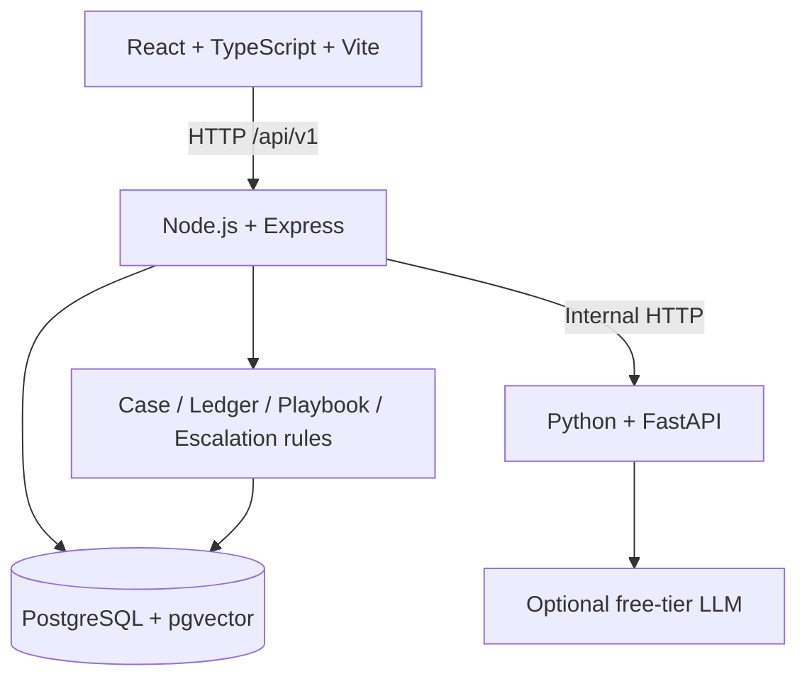

# Case Continuity Engine — Shared Contract

**Version:** 1.1 · **Status:** Authoritative  
**Purpose:** This document prevents implementation drift between backend, AI, and frontend.

---

## 1. Product definition

### 1.1 Problem

Support bots commonly answer the latest message without maintaining a reliable record of what happened to the customer's unresolved issue. This can cause the bot to suggest the same failed troubleshooting step repeatedly, make customers explain the problem again, and delay escalation.

### 1.2 Phase 1 outcome

Build a local demo support system for **internet-connectivity problems** that:

1. Stores each issue as a persistent case.
2. Links later sessions to the correct unresolved case for the same demo customer.
3. Records every recommended troubleshooting step and its outcome.
4. Prevents any step marked `failed` from being recommended again for that case.
5. Escalates deterministically after the third contact or when no playbook steps remain.
6. Shows the case timeline and an automatically assembled handoff summary.
7. Displays basic case and repeat-contact metrics in a dashboard.

### 1.3 Out of scope

No login/authentication, no real ISP account integration, no real outage lookup, no real remote line reset, no real technician booking, no live human-agent console, no production deployment requirements, no multilingual support, and no websockets. Three playbook actions are simulations, not real-world operations.

---

## 2. System architecture and ownership



### 2.1 Ownership rules

| Responsibility | Owner | Must not be owned by |
|---|---|---|
| Persist case, session, timeline, action ledger | Node.js + PostgreSQL | AI service, frontend |
| Decide if a new case can be created | Node.js | LLM alone |
| Select next eligible playbook step | Node.js | AI service, frontend |
| Enforce failed-step exclusion | Node.js | Prompt instructions alone |
| Decide escalation | Node.js | LLM, frontend |
| Interpret free-form language | Python AI service | Frontend |
| Suggest semantic case match from candidates | Python AI service | AI database queries |
| Display canonical case state | Frontend from backend response | Frontend-local derived state |
| Simulate outage/reset/technician actions | Backend mock handlers | Real external services |

The AI service must not connect to PostgreSQL. The browser must not call the AI service directly.

---

## 3. Runtime assumptions

- Local orchestration uses Docker Compose.
- Service names: `frontend`, `backend`, `ai-service`, `postgres`.
- Internal AI URL from backend: `http://ai-service:8000`.
- PostgreSQL runs in a pgvector-capable image.
- Frontend calls backend using a configurable base URL such as `VITE_API_BASE_URL=http://localhost:3000/api/v1`.
- Backend listens on port `3000`; AI service listens on port `8000`; frontend development server listens on port `5173`; PostgreSQL listens on `5432` inside the Compose network.
- The exact host port mapping can be changed in `.env`, but internal service URLs must use Compose service names.
- All timestamps returned by APIs are ISO 8601 UTC strings.
- All entity IDs are UUID strings.
- JSON field names use `camelCase` in API responses and requests. Database columns use `snake_case`.

---

## 4. Domain model and enums

### 4.1 Customer

A seeded demo identity, not an authenticated user.

| Field | Type | Required | Notes |
|---|---|---:|---|
| `id` | UUID | yes | Primary key |
| `displayName` | string | yes | Displayed in customer selector |
| `email` | string | no | Fake/demo data only |
| `createdAt` | ISO timestamp | yes | Server-generated |

### 4.2 Case

| Field | Type | Required | Notes |
|---|---|---:|---|
| `id` | UUID | yes | Primary key |
| `customerId` | UUID | yes | Must reference a seeded customer |
| `issueType` | enum | yes | Phase 1 only `internet_connectivity` |
| `title` | string | yes | Short display title, e.g. `Internet not working` |
| `problemSummary` | string | yes | Concise current issue description |
| `status` | enum | yes | `open`, `in_progress`, `escalated`, `resolved`, `closed` |
| `contactCount` | integer | yes | Starts at 1 when first session creates the case |
| `currentStepKey` | string/null | yes | Current action step, or null if none |
| `createdAt` | ISO timestamp | yes | Server-generated |
| `updatedAt` | ISO timestamp | yes | Updated on state change |
| `resolvedAt` | ISO timestamp/null | yes | Set only when resolved |
| `promisedDeadline` | ISO timestamp/null | yes | Reserved for future feature; Phase 1 may leave null |
| `lastContactAt` | ISO timestamp | yes | Updated on new session |
| `handoffSummary` | string/null | yes | Populated on escalation |

### 4.3 Case status

- `open`: case created but no troubleshooting action has yet been issued.
- `in_progress`: case has an active troubleshooting flow.
- `escalated`: automated troubleshooting has stopped and a handoff summary is available.
- `resolved`: customer explicitly confirmed the internet issue is fixed.
- `closed`: reserved; Phase 1 does not need a close action.

An `escalated` case is unresolved, but the bot must not continue automated troubleshooting for it.

### 4.4 Action ledger

Each row represents one playbook step recommended for a case. The system must preserve historical attempts rather than overwriting one action row when another step is recommended.

| Field | Type | Required | Notes |
|---|---|---:|---|
| `id` | UUID | yes | Action record ID |
| `caseId` | UUID | yes | Owning case |
| `stepKey` | enum/string | yes | One of the six stable keys |
| `stepOrder` | integer | yes | 1 through 6 |
| `label` | string | yes | User-facing label |
| `instructions` | string | yes | User-facing instructions |
| `status` | enum | yes | `recommended`, `attempted`, `failed`, `succeeded`, `unknown`, `skipped` |
| `recommendedAt` | ISO timestamp | yes | Server-generated |
| `outcomeAt` | ISO timestamp/null | yes | Set when outcome is recorded |
| `customerNote` | string/null | yes | Optional user-provided detail |

Customer-submitted outcomes are only `failed`, `succeeded`, or `unknown`. `attempted` means the user indicated that the recommended step was tried but has not supplied a final outcome yet. `not_provided` is AI-only and is never persisted. `skipped` is an audit state and should not be used as a customer outcome.

### 4.5 Stable playbook keys and content

The order below is fixed in Phase 1. Do not rename the keys in code, fixtures, or API responses.

| Order | `stepKey` | Label | Instructions / behavior |
|---:|---|---|---|
| 1 | `router_power_cycle` | Restart your router/modem | Turn the router/modem off, keep it off for 30 seconds, then turn it back on. Wait for the indicator lights to stabilize and test the connection. |
| 2 | `check_cables_lights` | Check cables and indicator lights | Check that power and network cables are firmly connected. Note any warning/red lights. Do not ask the customer to open equipment. |
| 3 | `check_area_outage` | Check for an area outage | **Mocked:** show a simulated status such as “No known outage in this demo.” Do not claim to have checked a real ISP. |
| 4 | `test_another_device` | Test another device or wired connection | Try another device on the same network, or test with Ethernet if available. This helps determine whether the issue affects one device or the whole connection. |
| 5 | `remote_line_reset` | Run a remote line reset | **Mocked:** show “Demo simulation: a remote line reset would be requested here.” No real reset occurs. |
| 6 | `book_technician` | Arrange a technician visit | **Mocked:** show “Demo simulation: a technician visit would be requested here.” No booking occurs. If unresolved after this final step, escalate. |

### 4.6 Case events

Allowed `type` values:

- `case_created`
- `contact_started`
- `message_received`
- `assistant_response`
- `action_recommended`
- `action_outcome_recorded`
- `case_escalated`
- `case_resolved`
- `case_reopened`
- `summary_generated`

Each event contains `id`, `caseId`, `type`, `message`, `metadata` (JSON object), and `createdAt`. Events are append-only. Do not delete timeline history when a case changes status.

---

## 5. Exact case lifecycle

### 5.1 First message from a customer

1. The customer selects one of the three seeded demo customers.
2. The frontend calls `POST /api/v1/sessions`.
3. If that customer has an unresolved case (`open` or `in_progress`), reuse it and increment `contactCount` once for this new session.
4. If no unresolved case exists, create a session with no case attached yet. Do not create a case before classifying the first message.
5. The frontend sends the first message to `POST /api/v1/sessions/:sessionId/messages`.
6. The backend asks the AI service to classify it.
7. If `off_topic`, return the fixed scope response and do not create a case.
8. If `uncertain`, return a clarification response and do not create a case yet.
9. If `internet_connectivity`, create the case with `contactCount=1`, append `case_created` and `contact_started` events, then select the first eligible playbook step and return it.

**Important implementation detail:** a new session can exist before a case. The first session only increments an existing case if one exists at session creation time. If the first message then creates a new case, that case starts with `contactCount=1`, not 2.

### 5.2 Returning customer

1. Customer clicks **Start New Chat**.
2. Frontend calls `POST /api/v1/sessions`.
3. Backend finds that customer's most recently updated unresolved case.
4. Backend increments `contactCount` exactly once and records `contact_started`.
5. If the count is now 3 or higher, backend escalates before any new troubleshooting recommendation.
6. Otherwise, the frontend receives the case and may send a new message. Backend resumes the case using its existing action ledger and history.

### 5.3 Action outcomes

- The backend returns at most one active action in `recommendedAction`.
- The customer chooses `failed`, `succeeded`, or `unknown`.
- `failed`: mark the action failed; append an outcome event; exclude this `stepKey` permanently for this case; select the next eligible step in playbook order. If none remain, escalate.
- `succeeded`: mark the action succeeded; resolve the case; set `resolvedAt`; append outcome and resolution events; do not offer more steps.
- `unknown`: mark the action unknown and ask the customer to clarify or retest. Do not silently advance as if it failed. Do not recommend a different step while the existing action's outcome is unresolved unless the product explicitly changes this rule.
- Duplicate submission of the same outcome for a terminal action returns the current state without duplicating events. A conflicting second terminal outcome returns `409 CONFLICT`.

### 5.4 Recommendation eligibility

A step is eligible only if:
- the case is not escalated, resolved, or closed;
- no other action is currently awaiting an outcome;
- the step has not been marked `failed` or `succeeded` for this case; and
- the playbook order permits it.

A step marked `unknown` is not treated as failed. It remains the current unresolved action and blocks selection of a different step until the customer clarifies the result. The UI should request clarification for that current action rather than recommending it again as a fresh action. A later clarification may change `unknown` to `failed` or `succeeded`; `failed` and `succeeded` are terminal outcomes.

### 5.5 Escalation

Escalate if either condition is true:
- `contactCount >= 3`, or
- the case is still unresolved and there are no eligible playbook steps remaining after an outcome.

Escalation operation must be idempotent. It sets status to `escalated`, generates/stores the handoff summary, appends one `case_escalated` event, and stops automated troubleshooting.

The handoff summary must include:
- case ID and issue title;
- current problem summary;
- contact count;
- case creation and latest contact timestamps;
- chronological timeline;
- every playbook step recommended and its recorded outcome;
- all failed steps;
- reason for escalation (`contact_limit_reached` or `playbook_exhausted`).

No human-agent console exists in Phase 1. The UI must say that this is a simulated handoff summary.

---

## 6. Case matching contract

- Matching candidates are limited to the currently selected customer's cases.
- Only unresolved cases are candidates for automated continuity (`open` or `in_progress`). Escalated cases may be shown in history but must not resume automated troubleshooting.
- Python returns a suggestion only; Node validates that the returned ID was supplied in `candidates`.
- Confidence guidance: `>= 0.80` may auto-match if exactly one eligible candidate exists; `0.55–0.79` requires user confirmation; `< 0.55` means no confident match.
- Thresholds are configuration values and must be covered by tests.
- If more than one plausible unresolved case exists, ask for confirmation instead of guessing.
- Never match or merge cases across customers.
- If a selected customer's unresolved case exists at session creation, the backend attaches the session to it according to the lifecycle above; semantic matching helps when the user describes the issue differently within that continuity flow. Do not silently create duplicate cases for an obvious recurrence.

---

## 7. Public HTTP API contract

**Base path:** `/api/v1`  
**Content type:** `application/json`  
**All request and response examples below omit standard HTTP headers.**

### 7.1 `GET /health`

**200**
```json
{ "status": "ok" }
```

### 7.2 `GET /customers`

Returns seeded customers for the selector.

**200**
```json
{
  "customers": [
    { "id": "11111111-1111-4111-8111-111111111111", "displayName": "Demo Customer 1" },
    { "id": "22222222-2222-4222-8222-222222222222", "displayName": "Demo Customer 2" },
    { "id": "33333333-3333-4333-8333-333333333333", "displayName": "Demo Customer 3" }
  ]
}
```
The seed script may use stable UUIDs as above, or create deterministic IDs, but application logic must always fetch IDs from the API rather than hardcode them.

### 7.3 `GET /cases?customerId={uuid}&status=open,in_progress,escalated`

**200**
```json
{
  "cases": [
    {
      "id": "aaaaaaaa-aaaa-4aaa-8aaa-aaaaaaaaaaaa",
      "customerId": "11111111-1111-4111-8111-111111111111",
      "issueType": "internet_connectivity",
      "title": "Internet connection not working",
      "status": "in_progress",
      "contactCount": 2,
      "currentStepKey": "check_cables_lights",
      "createdAt": "2026-10-18T00:00:00Z",
      "updatedAt": "2026-10-18T00:05:00Z",
      "lastContactAt": "2026-10-18T00:05:00Z"
    }
  ]
}
```

### 7.4 `POST /sessions`

Creates a new chat session and applies the contact-count rule.

**Request**
```json
{ "customerId": "11111111-1111-4111-8111-111111111111" }
```

**201 — no existing unresolved case**
```json
{
  "sessionId": "bbbbbbbb-bbbb-4bbb-8bbb-bbbbbbbbbbbb",
  "customerId": "11111111-1111-4111-8111-111111111111",
  "case": null,
  "escalationRequired": false,
  "handoffSummary": null
}
```

**201 — returning customer**
```json
{
  "sessionId": "cccccccc-cccc-4ccc-8ccc-cccccccccccc",
  "customerId": "11111111-1111-4111-8111-111111111111",
  "case": {
    "id": "aaaaaaaa-aaaa-4aaa-8aaa-aaaaaaaaaaaa",
    "customerId": "11111111-1111-4111-8111-111111111111",
    "issueType": "internet_connectivity",
    "title": "Internet connection not working",
    "status": "in_progress",
    "contactCount": 2,
    "currentStepKey": "check_cables_lights",
    "createdAt": "2026-10-18T00:00:00Z",
    "updatedAt": "2026-10-18T00:05:00Z",
    "lastContactAt": "2026-10-18T00:05:00Z"
  },
  "escalationRequired": false,
  "handoffSummary": null
}
```

On the third session, the response's `case.status` is `escalated`, `escalationRequired` is `true`, and `handoffSummary` is a string.

**400**
```json
{
  "error": {
    "code": "VALIDATION_ERROR",
    "message": "customerId must be a valid UUID",
    "requestId": "req-example"
  }
}
```

### 7.5 `POST /sessions/:sessionId/messages`

**Request**
```json
{ "message": "My Wi-Fi is down again and nothing loads." }
```

**200 — in-scope issue and action returned**
```json
{
  "sessionId": "bbbbbbbb-bbbb-4bbb-8bbb-bbbbbbbbbbbb",
  "case": {
    "id": "aaaaaaaa-aaaa-4aaa-8aaa-aaaaaaaaaaaa",
    "customerId": "11111111-1111-4111-8111-111111111111",
    "issueType": "internet_connectivity",
    "title": "Internet connection not working",
    "problemSummary": "Customer reports Wi-Fi/internet is unavailable.",
    "status": "in_progress",
    "contactCount": 1,
    "currentStepKey": "router_power_cycle",
    "createdAt": "2026-10-18T00:00:00Z",
    "updatedAt": "2026-10-18T00:00:00Z",
    "lastContactAt": "2026-10-18T00:00:00Z",
    "resolvedAt": null,
    "promisedDeadline": null,
    "handoffSummary": null,
    "actions": [
      {
        "id": "dddddddd-dddd-4ddd-8ddd-dddddddddddd",
        "caseId": "aaaaaaaa-aaaa-4aaa-8aaa-aaaaaaaaaaaa",
        "stepKey": "router_power_cycle",
        "stepOrder": 1,
        "label": "Restart your router/modem",
        "instructions": "Turn it off for 30 seconds, turn it on, wait for lights, then test.",
        "status": "recommended",
        "recommendedAt": "2026-10-18T00:00:00Z",
        "outcomeAt": null,
        "customerNote": null
      }
    ],
    "events": [],
    "handoffSummary": null
  },
  "reply": {
    "text": "I'm sorry your internet is not working. Let's try one step at a time. First, turn your router/modem off for 30 seconds, turn it back on, wait for the lights to stabilize, and test the connection.",
    "kind": "troubleshooting"
  },
  "recommendedAction": {
    "id": "dddddddd-dddd-4ddd-8ddd-dddddddddddd",
    "caseId": "aaaaaaaa-aaaa-4aaa-8aaa-aaaaaaaaaaaa",
    "stepKey": "router_power_cycle",
    "stepOrder": 1,
    "label": "Restart your router/modem",
    "instructions": "Turn it off for 30 seconds, turn it on, wait for lights, then test.",
    "status": "recommended",
    "recommendedAt": "2026-10-18T00:00:00Z",
    "outcomeAt": null,
    "customerNote": null
  },
  "needsOutcome": true
}
```

**200 — off-topic first message**
```json
{
  "sessionId": "bbbbbbbb-bbbb-4bbb-8bbb-bbbbbbbbbbbb",
  "case": null,
  "reply": {
    "text": "I can currently help only with internet-connectivity issues. Please describe the internet problem you are experiencing.",
    "kind": "scope"
  },
  "recommendedAction": null,
  "needsOutcome": false
}
```

**200 — uncertain classification/match**
```json
{
  "sessionId": "bbbbbbbb-bbbb-4bbb-8bbb-bbbbbbbbbbbb",
  "case": null,
  "reply": {
    "text": "I want to make sure I track the right issue. Are you having a problem with your home internet connection?",
    "kind": "clarification"
  },
  "recommendedAction": null,
  "needsOutcome": false
}
```

### 7.6 `POST /cases/:caseId/actions/:actionId/outcome`

**Request**
```json
{
  "outcome": "failed",
  "customerNote": "The router lights came back, but there is still no internet."
}
```

**200 — failed and next step available**
```json
{
  "case": {
    "id": "aaaaaaaa-aaaa-4aaa-8aaa-aaaaaaaaaaaa",
    "customerId": "11111111-1111-4111-8111-111111111111",
    "issueType": "internet_connectivity",
    "title": "Internet connection not working",
    "problemSummary": "Customer reports Wi-Fi/internet is unavailable.",
    "status": "in_progress",
    "contactCount": 1,
    "currentStepKey": "check_cables_lights",
    "createdAt": "2026-10-18T00:00:00Z",
    "updatedAt": "2026-10-18T00:02:00Z",
    "lastContactAt": "2026-10-18T00:00:00Z",
    "resolvedAt": null,
    "promisedDeadline": null,
    "handoffSummary": null,
    "actions": [],
    "events": [],
    "handoffSummary": null
  },
  "reply": {
    "text": "Thanks for checking. I won't recommend that step again for this case. Next, please check the power and network cables and note any warning lights.",
    "kind": "troubleshooting"
  },
  "recommendedAction": {
    "id": "eeeeeeee-eeee-4eee-8eee-eeeeeeeeeeee",
    "caseId": "aaaaaaaa-aaaa-4aaa-8aaa-aaaaaaaaaaaa",
    "stepKey": "check_cables_lights",
    "stepOrder": 2,
    "label": "Check cables and indicator lights",
    "instructions": "Check power/network cables and note warning lights.",
    "status": "recommended",
    "recommendedAt": "2026-10-18T00:02:00Z",
    "outcomeAt": null,
    "customerNote": null
  }
}
```

For a `succeeded` outcome, mark the action succeeded and case status `resolved`, set `resolvedAt`, and return `recommendedAction: null`. For `unknown`, persist `unknown`, return a clarification reply, and do not advance the playbook.

### 7.7 `GET /cases/:caseId`

Returns `{ "case": CaseDetail }`, where `CaseDetail` contains the fields in `CaseSummary` plus `problemSummary`, `resolvedAt`, `promisedDeadline`, `actions`, `events`, and `handoffSummary`.

### 7.8 `GET /cases/:caseId/timeline`

Returns:
```json
{
  "events": [
    {
      "id": "event-uuid",
      "caseId": "case-uuid",
      "type": "action_outcome_recorded",
      "message": "Customer marked Restart your router/modem as failed.",
      "metadata": {
        "stepKey": "router_power_cycle",
        "outcome": "failed"
      },
      "createdAt": "2026-10-18T00:02:00Z"
    }
  ]
}
```
Events must be ordered oldest to newest.

### 7.9 `GET /dashboard/metrics`

Returns rates as decimals in the range `0.0` to `1.0`, not percentages.

```json
{
  "totalCases": 12,
  "openCases": 2,
  "escalatedCases": 3,
  "resolvedCases": 7,
  "repeatContactRate": 0.25,
  "repeatedRecommendationRate": 0.0
}
```

Definitions:
- `repeatContactRate = count(cases where contact_count >= 2) / count(cases with at least one contact)`.
- `repeatedRecommendationRate = count(recommendations whose stepKey had previously been marked failed in the same case) / count(all recommendations)`.
- If a denominator is zero, return `0.0`.
- A non-zero repeated-recommendation rate is a defect signal; the backend must prevent such recommendations.

### 7.10 `GET /cases/:caseId/handoff-summary`

Returns:
```json
{
  "caseId": "aaaaaaaa-aaaa-4aaa-8aaa-aaaaaaaaaaaa",
  "summary": "Internet connection not working. Customer contacted support 3 times. Failed steps: Restart your router/modem. Escalation reason: contact limit reached.",
  "contactCount": 3,
  "failedActions": ["router_power_cycle"],
  "timeline": []
}
```

### 7.11 Error envelope

Every error response uses:
```json
{
  "error": {
    "code": "CONFLICT",
    "message": "This action already has a different final outcome.",
    "requestId": "req-example"
  }
}
```

Allowed codes: `VALIDATION_ERROR`, `NOT_FOUND`, `CONFLICT`, `AI_UNAVAILABLE`, `INTERNAL_ERROR`.

| HTTP status | Use |
|---:|---|
| 400 | Invalid request fields, invalid enum, malformed input |
| 404 | Session, customer, case, or action not found |
| 409 | Invalid state transition or conflicting duplicate outcome |
| 503 | AI unavailable when no safe deterministic fallback applies |
| 500 | Unexpected server error |

Never return stack traces or secrets to the browser.

---

## 8. Database requirements

Use migrations checked into source control. Use a PostgreSQL image that supports pgvector, even if the first matching implementation uses embeddings only as an optional aid.

### 8.1 Tables

#### `customers`
- `id UUID PRIMARY KEY`
- `display_name TEXT NOT NULL`
- `email TEXT NULL`
- `created_at TIMESTAMPTZ NOT NULL DEFAULT now()`

#### `cases`
- `id UUID PRIMARY KEY`
- `customer_id UUID NOT NULL REFERENCES customers(id)`
- `issue_type TEXT NOT NULL CHECK (issue_type IN ('internet_connectivity'))`
- `title TEXT NOT NULL`
- `problem_summary TEXT NOT NULL`
- `status TEXT NOT NULL CHECK (status IN ('open','in_progress','escalated','resolved','closed'))`
- `contact_count INTEGER NOT NULL DEFAULT 1 CHECK (contact_count >= 1)`
- `current_step_key TEXT NULL`
- `created_at TIMESTAMPTZ NOT NULL DEFAULT now()`
- `updated_at TIMESTAMPTZ NOT NULL DEFAULT now()`
- `resolved_at TIMESTAMPTZ NULL`
- `promised_deadline TIMESTAMPTZ NULL`
- `last_contact_at TIMESTAMPTZ NOT NULL DEFAULT now()`
- `handoff_summary TEXT NULL`

Indexes: `(customer_id, status, updated_at DESC)` and `(status, updated_at DESC)`.

#### `chat_sessions`
- `id UUID PRIMARY KEY`
- `customer_id UUID NOT NULL REFERENCES customers(id)`
- `case_id UUID NULL REFERENCES cases(id)`
- `created_at TIMESTAMPTZ NOT NULL DEFAULT now()`
- `last_message_at TIMESTAMPTZ NULL`

The session may initially have `case_id=NULL`; set it when the first in-scope message creates or matches a case.

#### `case_events`
- `id UUID PRIMARY KEY`
- `case_id UUID NOT NULL REFERENCES cases(id)`
- `session_id UUID NULL REFERENCES chat_sessions(id)`
- `type TEXT NOT NULL CHECK (type IN ('case_created','contact_started','message_received','assistant_response','action_recommended','action_outcome_recorded','case_escalated','case_resolved','case_reopened','summary_generated'))`
- `message TEXT NOT NULL`
- `metadata JSONB NOT NULL DEFAULT '{}'::jsonb`
- `created_at TIMESTAMPTZ NOT NULL DEFAULT now()`

Index: `(case_id, created_at ASC)`.

#### `action_ledger`
- `id UUID PRIMARY KEY`
- `case_id UUID NOT NULL REFERENCES cases(id)`
- `step_key TEXT NOT NULL`
- `step_order INTEGER NOT NULL CHECK (step_order BETWEEN 1 AND 6)`
- `label TEXT NOT NULL`
- `instructions TEXT NOT NULL`
- `status TEXT NOT NULL CHECK (status IN ('recommended','attempted','failed','succeeded','unknown','skipped'))`
- `recommended_at TIMESTAMPTZ NOT NULL DEFAULT now()`
- `outcome_at TIMESTAMPTZ NULL`
- `customer_note TEXT NULL`

Index: `(case_id, step_order)` and `(case_id, step_key, status)`. Add a partial uniqueness constraint or transactional rule so only one action per case can be active (`recommended`, `attempted`, or `unknown`). An `unknown` action blocks new recommendations until clarified. Allow `unknown` to transition to `failed` or `succeeded`; once `failed` or `succeeded`, the outcome is terminal.

#### `playbook_steps`
- `step_key TEXT PRIMARY KEY`
- `step_order INTEGER NOT NULL UNIQUE CHECK (step_order BETWEEN 1 AND 6)`
- `label TEXT NOT NULL`
- `instructions TEXT NOT NULL`
- `is_mocked BOOLEAN NOT NULL DEFAULT false`

Seed exactly the six rows in Section 4.5.

### 8.2 Vector search

The database image must include pgvector. Phase 1 may use embeddings as a matching aid, but must not make vector similarity the only decision rule. If embeddings are unavailable because the chosen free provider is unavailable, the service must fall back to text/structured matching and ask for clarification when uncertain. Store any embedding metadata in a clearly documented table/column; do not make the rest of the app depend on an undocumented vector schema.

### 8.3 Transactions and concurrency

- Contact increment and `contact_started` event creation must be atomic.
- Outcome update, event creation, next action selection, and possible escalation must be atomic.
- Lock the case row (`SELECT ... FOR UPDATE`) while changing contact count or selecting a new action.
- Repeating the same request must not duplicate contact increments or terminal outcome events. The implementation may add a request idempotency key, but it must document the mechanism and preserve API compatibility.
- No frontend-provided status or contact count may be trusted.

---

## 9. Internal AI service contract

Base URL from backend: `http://ai-service:8000`.

### 9.1 `POST /internal/v1/classify`

Request:
```json
{
  "message": "My internet keeps disconnecting",
  "allowedIssueTypes": ["internet_connectivity"]
}
```
Response:
```json
{
  "category": "internet_connectivity",
  "confidence": 0.96,
  "reason": "The message explicitly describes an internet connection problem."
}
```
Allowed category values: `internet_connectivity`, `off_topic`, `uncertain`.

### 9.2 `POST /internal/v1/match-case`

Request:
```json
{
  "message": "It is still down like yesterday",
  "candidates": [
    {
      "caseId": "aaaaaaaa-aaaa-4aaa-8aaa-aaaaaaaaaaaa",
      "title": "Internet connection not working",
      "problemSummary": "Customer reports no internet access.",
      "status": "in_progress",
      "lastContactAt": "2026-10-18T00:00:00Z",
      "failedStepKeys": ["router_power_cycle"]
    }
  ]
}
```
Response:
```json
{
  "matchedCaseId": "aaaaaaaa-aaaa-4aaa-8aaa-aaaaaaaaaaaa",
  "confidence": 0.91,
  "needsConfirmation": false,
  "reason": "The message refers to the same unresolved connection problem."
}
```
`matchedCaseId` must be one of the supplied candidate IDs or null.

### 9.3 `POST /internal/v1/extract-outcome`

Request:
```json
{
  "message": "I tried it but the internet is still down",
  "currentStepKey": "router_power_cycle"
}
```
Response:
```json
{
  "outcome": "failed",
  "confidence": 0.94,
  "evidence": "The user says the internet is still down after trying the step."
}
```
Allowed outcome values: `failed`, `succeeded`, `unknown`, `not_provided`.

The backend must not persist an outcome based only on low-confidence extraction. The explicit outcome buttons in the UI are the primary path; AI extraction is an optional assist.

---

## 10. Independent and integrated testing

### Backend independent tests
- Mock AI HTTP client.
- Use dedicated PostgreSQL test database for repository/transaction tests.
- Do not require Python, external API, or internet for `npm test`.

### AI independent tests
- Use `pytest` and a deterministic fake provider.
- No API key, Node.js, PostgreSQL, or network access required for the default test suite.

### Frontend independent tests
- Use Vitest, React Testing Library, and MSW.
- No running backend, AI service, database, credentials, or external network required for `npm test`.

### Database tests
- Apply migrations to a clean pgvector-enabled test database.
- Test constraints, foreign keys, transaction rollback, indexes where practical, and repository operations.

### Full integration tests
Run separately after independent tests pass. Start all services with Docker Compose and test the full customer journey.

---

## 11. Acceptance checklist

- [ ] Off-topic first message creates no case.
- [ ] First in-scope message creates one case with `contactCount=1`.
- [ ] Additional messages in the same session do not change `contactCount`.
- [ ] New session for an unresolved case increments `contactCount` once.
- [ ] Third contact escalates before another troubleshooting step is returned.
- [ ] A failed step is never recommended again for that case.
- [ ] Success resolves the case and stops the playbook.
- [ ] Unknown outcome is not treated as failure.
- [ ] Exhausted playbook escalates.
- [ ] Escalation summary includes contact count, timeline, failed steps, and reason.
- [ ] Frontend never calls the AI service directly.
- [ ] AI service has no database access.
- [ ] All component suites pass independently.
- [ ] Full Compose integration test passes.
